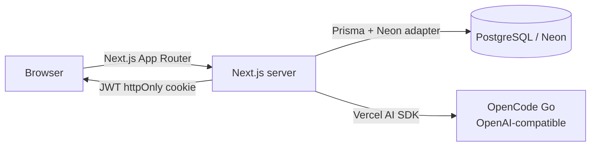

# VetLéxico · `vet-lexical`

> An AI-powered glossary and flashcard app for veterinary medicine students.

[](https://nextjs.org)
[](https://react.dev)
[](https://www.typescriptlang.org)
[](https://www.prisma.io)
[](https://tailwindcss.com)
[](https://vercel.com)

**Live demo:** [vet-lexical.vercel.app](https://vet-lexical.vercel.app) — demo access on request

---

## Overview

VetLéxico is a small, focused product built to solve a real, recurring problem: a
veterinary medicine student keeps encountering unfamiliar technical terms, looks
them up on the web, writes the meaning down somewhere, and then loses the notes.

The app turns that chaotic workflow into a single loop:

**look up → understand → save → review**

- Type a term and get a dictionary-style definition plus **bibliographic usage
  examples** from veterinary literature.
- Save the note to a permanent **glossary**.
- Turn any glossary word into a **flashcard**, create cards manually, or ask the
  AI to generate a deck from a topic.
- Review everything with a simple two-sided study mode.

The product UI is in **Brazilian Portuguese** (pt-BR) because that is the target
user's language. This README and the codebase are documented in English.

---

## The problem

| Before | After |
| --- | --- |
| Search the web for every new term | One search box with a veterinary-focused assistant |
| Copy definitions into random notes | Every word is saved to a structured glossary |
| Notes get lost | Data lives in PostgreSQL and is always reachable |
| Passive reading | Active recall through flashcards |

The goal was **not** to build another generic dictionary. It was to make the
study loop fast enough that it actually gets used on a phone between classes.

---

## Features

### AI word lookup
- Veterinary-focused definitions in pt-BR.
- Structured output: term, definition, examples **with sources**, synonyms, and
  an optional note.
- Bibliographic examples instead of invented sentences (see
  [How AI is used](#how-ai-is-used)).
- One-click **Save to glossary**.
- The searched term is highlighted inside the definition and examples.

### Glossary
- Searchable/filterable list of every saved word.
- Edit any note in a modal (term, meaning, examples, synonyms, note).
- Delete with confirmation.
- Convert a word into a flashcard in one tap (idempotent — no duplicates).

### Flashcards
- **Study mode**: 3D card flip, progress bar, self-assessment ("know it" /
  "review"), shuffle, and a session summary that offers to retry only the cards
  you missed.
- **Manual creation**: front/back in your own words.
- **AI generation**: describe a topic and get a reviewable batch of cards before
  saving.
- **Manage**: edit and delete existing cards.

### Access
- Single-account authentication (this is a personal tool, not a multi-tenant
  SaaS).
- Session stored in an httpOnly JWT cookie.
- All pages and API routes are protected.

---

## How AI is used

This is the part of the project with the most deliberate engineering.

### Provider and model

| Item | Value |
| --- | --- |
| Provider | [OpenCode Go](https://opencode.ai) (OpenAI-compatible) |
| Endpoint | `https://opencode.ai/inference/go/openai/v1/chat/completions` |
| Default model | `beam-free` (free tier) |
| Override | `AI_MODEL` environment variable |
| SDK | Vercel AI SDK (`ai` + `@ai-sdk/openai-compatible`) |

The provider is isolated in [`lib/ai.ts`](lib/ai.ts). Swapping models or moving
to another OpenAI-compatible provider is a one-file change.

### Two AI capabilities

**1. Term definition** — returns a single structured object:

```json
{
  "termo": "cianose",
  "definicao": "Coloração azulada da pele e mucosas por hipoxemia...",
  "exemplos": [
    {
      "texto": "A cianose é um sinal clínico de oxigenação inadequada...",
      "fonte": "Merck Veterinary Manual"
    }
  ],
  "sinonimos": ["azulamento"],
  "observacao": "..."
}
```

**2. Flashcard generation** — returns an array of `{ frente, verso }` cards from
a topic or context.

### Prompt design

The definition prompt is intentionally strict:

- Always pt-BR, always veterinary context.
- Output **only** valid JSON.
- Examples must be **bibliographic** (excerpts or faithful paraphrases from
  recognized veterinary sources), not invented sentences.
- Each example carries a `fonte` (source) field.
- **Anti-hallucination rule:** never fabricate a citation. If the exact
  reference is unknown, the model must write `"Referência não identificada"`
  instead of inventing an author or book.

### Robustness decisions

LLMs are unreliable JSON generators, and free-tier models are even less
predictable. The integration was built to degrade gracefully:

- **Tolerant parsing** — strips Markdown code fences, extracts the JSON object
  or array from surrounding text, and only then parses it.
- **Zod validation** — every AI response is validated against a schema.
- **Model-agnostic schema** — examples accept either a plain string or a
  `{ texto, fonte }` object and are normalized, so a model that ignores the
  format does not break the UI.
- **Graceful fallback** — if parsing fails entirely, the raw text is shown as
  the definition instead of throwing a 500.
- **Session header** — requests send `x-opencode-session` and a custom
  `User-Agent`, as recommended by the provider.
- **Non-streaming structured output** — I chose structured JSON over token
  streaming because rendering a definition requires all fields at once; the
  perceived speed comes from skeleton loading and fast transitions instead.

### Honest limitations

- The model has **no live web or bibliographic retrieval**. Sources are
  generated from the model's training data and should be verified. The prompt
  strongly discourages fabrication, but it cannot guarantee real citations.
- The production-grade upgrade is **retrieval-augmented generation (RAG)** over
  trusted veterinary sources (textbooks, Merck Veterinary Manual, PubMed), with
  the model citing retrieved passages. This is on the roadmap.
- Free-tier models can be rate-limited. The model is configurable so a paid
  model can be swapped in without code changes.

---

## Architecture



### Request flow (word lookup)

1. The client posts the term to `POST /api/words/search`.
2. The route checks the session, validates input with Zod, and calls
   `searchWord()` in `lib/ai.ts`.
3. The AI returns JSON, which is extracted, validated, and normalized.
4. The client renders the result and offers **Save to glossary**.
5. Saving calls `POST /api/glossary`, which persists to PostgreSQL via Prisma.

---

## Tech stack

| Layer | Technology | Why |
| --- | --- | --- |
| Framework | Next.js 16 (App Router) + React 19 | Full-stack in one project, server components, route handlers |
| Language | TypeScript | End-to-end type safety |
| Styling | Tailwind CSS v4 | Fast, consistent, mobile-first UI |
| Database | PostgreSQL on Neon | Serverless Postgres that pairs with Vercel |
| ORM | Prisma 7 + `@prisma/adapter-neon` | Type-safe data access with a serverless driver adapter |
| Auth | `jose` (JWT) + `bcryptjs` | Minimal, dependency-light single-account auth |
| AI | Vercel AI SDK + OpenCode Go | Provider-agnostic, structured output |
| Validation | Zod | Runtime validation for every boundary |
| Deploy | Vercel | Zero-config Next.js hosting |

---

## Data model

```prisma
model User {
  id           String   @id @default(cuid())
  email        String   @unique
  passwordHash String
  createdAt    DateTime @default(now())
}

model GlossaryEntry {
  id         String      @id @default(cuid())
  term       String
  definition String
  examples   String[]
  synonyms   String[]
  note       String?
  createdAt  DateTime    @default(now())
  updatedAt  DateTime    @updatedAt
  flashcards Flashcard[]

  @@index([term])
}

model Flashcard {
  id              String         @id @default(cuid())
  front           String
  back            String
  source          String         @default("manual") // manual | glossary | ai
  glossaryEntryId String?
  glossaryEntry   GlossaryEntry? @relation(fields: [glossaryEntryId], references: [id], onDelete: SetNull)
  createdAt       DateTime       @default(now())

  @@index([createdAt])
}
```

`examples` stores `"excerpt — source"` strings, preserving the bibliographic
reference inside the glossary.

---

## API

| Method | Route | Purpose |
| --- | --- | --- |
| `POST` | `/api/auth/login` | Verify password, issue session cookie |
| `POST` | `/api/auth/logout` | Clear session |
| `GET` | `/api/auth/me` | Session check |
| `POST` | `/api/words/search` | AI definition + examples |
| `GET` | `/api/glossary` | List/search glossary entries |
| `POST` | `/api/glossary` | Create entry |
| `PUT` | `/api/glossary/[id]` | Update entry |
| `DELETE` | `/api/glossary/[id]` | Delete entry |
| `GET` | `/api/flashcards` | List cards |
| `POST` | `/api/flashcards` | Create one card |
| `PUT` | `/api/flashcards/[id]` | Update card |
| `DELETE` | `/api/flashcards/[id]` | Delete card |
| `POST` | `/api/flashcards/bulk` | Save an AI-generated batch |
| `POST` | `/api/flashcards/generate` | Generate cards from a topic |
| `POST` | `/api/flashcards/from-glossary/[id]` | Convert a word into a card |

---

## Security

- **Password hashing:** bcrypt (`bcryptjs`).
- **Session:** signed JWT (HS256) in an `httpOnly`, `sameSite=lax` cookie,
  `secure` in production, 30-day expiry.
- **Route protection:**
  - Server layout calls `requireUser()` and redirects unauthenticated users.
  - Every API route calls `getUserId()` and returns `401` without a valid session.
- **Secrets:** `DATABASE_URL`, `OPENCODE_API_KEY`, and `AUTH_SECRET` live in
  environment variables; `.env` is gitignored.
- **Validation:** all request bodies and AI outputs are validated with Zod.

---

## UX and design

The brief was simple, interactive, and fluid:

- **Mobile-first** with three primary areas: Search · Glossary · Flashcards.
- Header on desktop, bottom tab bar on mobile.
- **3D flip** flashcards with self-assessment and session recap.
- **Skeletons** for AI latency, **toasts** for feedback, friendly empty states.
- Accessible focus rings and semantic labels.
- A restrained **white + pink** palette with the searched term highlighted.

---

## Getting started

### 1. Install

```bash
pnpm install
```

### 2. Configure the environment

```bash
cp .env.example .env
```

Fill in:

| Variable | Description |
| --- | --- |
| `DATABASE_URL` | Neon PostgreSQL connection string |
| `OPENCODE_API_KEY` | Personal key from the OpenCode Console |
| `AUTH_SECRET` | Random secret (`openssl rand -base64 32`) |
| `SEED_EMAIL` / `SEED_PASSWORD` | Credentials for the single account |
| `AI_MODEL` | Optional model override (default `beam-free`) |

### 3. Create the schema and the account

```bash
pnpm db:push
pnpm db:seed
```

### 4. Run

```bash
pnpm dev
```

Open <http://localhost:3000> and sign in with the seeded credentials.

---

## Deployment

The app is deployed on **Vercel** with **Neon** as the database.

1. Import the repository into Vercel.
2. Add the environment variables above.
3. `prisma generate` runs automatically on install (`postinstall`).
4. Apply the schema against the Neon database (`pnpm db:push`) and seed the
   account (`pnpm db:seed`).

The Prisma 7 client uses the Neon serverless driver adapter, which is the
recommended setup for serverless Postgres.

---

## Project structure

```text
app/
  login/                 # sign-in
  (app)/                 # protected area
    buscar/              # AI word lookup
    glossario/           # glossary
    flashcards/          # study / create / manage
  api/                   # route handlers (auth, words, glossary, flashcards)
components/
  flashcards/            # flip card, study, create, manage
  app-nav.tsx            # header + mobile tab bar
  modal.tsx, toast.tsx, icons.tsx
lib/
  ai.ts                  # provider, prompts, parsing, Zod schemas
  auth.ts                # JWT session helpers
  prisma.ts              # Prisma + Neon adapter singleton
  types.ts, client-api.ts
prisma/
  schema.prisma          # User, GlossaryEntry, Flashcard
  seed.ts                # creates the single account
```

---

## Roadmap

- **RAG for verified citations** — retrieve passages from trusted veterinary
  sources and have the model cite real references.
- **Spaced repetition** — SM-2 or FSRS scheduling instead of a linear session.
- **Decks and tags** — organize cards by subject.
- **Multi-user support** — scope glossary/cards to a `userId`.
- **PWA / offline study**.
- **Export/import** — CSV or Anki-compatible export.

---

## What this project demonstrates

- End-to-end product thinking: from a real user problem to a shipped app.
- Practical LLM integration: prompt design, structured output, validation,
  graceful failure, and an honest treatment of hallucinations.
- Full-stack TypeScript with a modern Next.js App Router architecture.
- Serverless data with Prisma 7 driver adapters and Neon.
- Security fundamentals: hashing, signed cookies, protected routes, validation.
- Attention to UX: mobile-first layout, feedback, motion, and accessibility.

---

## License

MIT
